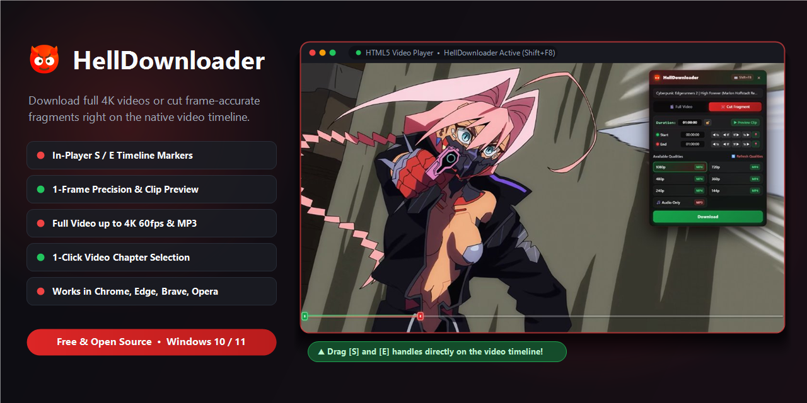

<div align="center">
  

  # 😈 HellDownloader

  **Universal HTML5 video & frame-accurate fragment downloader for Chromium browsers on Windows 10/11.**

  <p>
    
    
    
    
    
    
    
    
  </p>

  <p>
    <a href="https://github.com/ArkadyYum/HellDownloader/releases/latest"></a>
    <a href="https://github.com/ArkadyYum/HellDownloader/releases/latest/download/HellDownloader_Setup.zip"></a>
    
    
  </p>

  <p>
    🌐 <b>Language / Язык:</b> &nbsp; <b>🇬🇧 English</b> &nbsp;·&nbsp; <a href="README.ru.md"><b>🇷🇺 Русский (Нажмите здесь)</b></a>
  </p>

  <p>
    <i>No separate browser to sign into, no copy-pasting links, no ads. If HellDownloader saves you time, a ⭐ in the top-right corner helps others find it!</i>
  </p>
</div>

---

## ✨ Key Features

* **🎬 Full Video or ✂️ Frame-Accurate Fragment Cut:** Start (`S`) and End (`E`) handles mount directly onto the video player's native timeline scrub bar while you watch.
* **Frame-by-Frame Precision (`1f` / `1s`):** Fine-tune clip boundaries, lock clip duration (`🔒`), and loop-preview your exact cut (`▶ Preview Clip`) before downloading.
* **1-Click Chapter Selection:** Clicking any chapter segment on the video timeline automatically snaps the `S` and `E` markers to that chapter's start and end times and pre-fills the chapter title.
* **Works Directly in Your Own Browser:** No need to copy-paste URLs into a separate desktop app or sign into a secondary embedded browser — uses your active browser session seamlessly.
* **Live Stream Recording:** Record clips directly from active live streams.
* **Built-in DoH Bridge:** Works reliably even when your ISP's DNS is unstable or restricted.
* **Works Across All Chromium Browsers:** Google Chrome, Microsoft Edge, Brave, Opera / Opera GX, Vivaldi, Yandex Browser.
* **Silent Auto-Updates:** Automatically checks for core & media engine updates once every 24 hours in the background.

---

## 📥 1-CLICK DOWNLOAD & INSTALLATION (Takes 1 Minute)

> **No need to browse the source files above!** Click the big link below to immediately download the ready-to-use Windows installer package:

<div align="center">

### 👉 [**DOWNLOAD HellDownloader_Setup.zip (Windows 10/11 Installer)**](https://github.com/ArkadyYum/HellDownloader/releases/latest/download/HellDownloader_Setup.zip) 👈

</div>


### Quick Summary:
1. **Run `install.bat`:** Extract `HellDownloader_Setup.zip` into any folder and double-click **`install.bat`** (*if Windows SmartScreen prompts you, click **More info** → **Run anyway***).
2. **Open Chrome Extensions:** Click the **Three Dots `⋮`** in the top-right corner of your browser → **Extensions** → **Manage Extensions** (or open `chrome://extensions`).
3. **Enable & Load:** Turn **ON** **Developer mode** (top-right), then click **Load unpacked** (top-left).
4. **Select the `extension` folder:** In the folder window that opens, select the **`extension`** subfolder inside your unpacked folder (or simply press **`Ctrl+V`**) and click **Select Folder**.
5. **Done!** Open any video in your browser and press **`Shift+F8`** on your keyboard (you can change the shortcut anytime in the panel header).

### 🗑️ How to Uninstall:
* Double-click **`uninstall.bat`** — it removes the runtime files and cleans up the browser registry keys in 1 second.
* Click **Remove** on the **HellDownloader** card on `chrome://extensions`.

---

## ❤️ Support the Project

HellDownloader is 100% free. If it saves you time and you enjoy using it, you can support the author:
* 🔥 **[Donate via DonationAlerts](https://www.donationalerts.com/r/yumarkady)**

Found a bug on a specific website? Click the **`😡 Report Bug`** button inside the extension panel after a download to send an instant diagnostic report to the developer.

---

## 🛠️ Project Architecture (For Developers & AI Coding Assistants)

This section is designed so developers and AI coding assistants (Cursor, Claude, ChatGPT, Antigravity) can immediately understand and work on the project after cloning:

### Repository Structure
* `extension/` — Manifest V3 Chromium browser extension:
  * `manifest.json` — uses a fixed public RSA `key` so the extension always gets the deterministic ID `ldaapocpnahcghkpfbdokiphpbicaonk` on every machine.
  * `unclose_shadow.js` (`world: "MAIN"`, `document_start`) — hooks `Element.prototype.attachShadow` to expose closed Shadow DOM trees for `<video>` discovery and extracts player metadata/stream manifests.
  * `content.js` + `content.css` (`document_idle`, `all_frames: true`) — renders the floating `#vc-clipper-panel` (promoted into the browser's native `#top-layer` via `popover="manual"`) and mounts `#vc-native-markers` onto the native video timeline. Synchronizes state across top frames and cross-origin player `<iframe>`s.
  * `background.js` — MV3 service worker that captures media stream URLs (`.m3u8`, `.mpd`, `ct=6`, `/video/tos/`) via `chrome.webRequest`, exports authenticated tab cookies in Netscape format, and communicates with the local Native Host via `chrome.runtime.connectNative('com.vibecoding.videoclipper')`.
* `native_host/` — Local Node.js backend:
  * `host.js` — handles Native Messaging commands (`ping`, `get_formats`, `download`, `cancel`, `cleanup`, `send_feedback`). Orchestrates the media engine and `ffmpeg.exe`, serves finished files via a one-time loopback HTTP server on `127.0.0.1` into `chrome.downloads.download({ saveAs: true })`, includes a built-in DoH resolver (`1.1.1.1` / `8.8.8.8`), performs silent 24h GitHub auto-updates (`maybeAutoUpdateFromGitHub`), and forwards user bug reports to Telegram.
  * `register.js` — copies runtime files to `C:\Users\Public\HellDownloader` and registers the Native Messaging Host in the Windows Registry (`HKCU\Software\...\NativeMessagingHosts\com.vibecoding.videoclipper`).
  * `ext_key.json` — public RSA key metadata.

### Development Workflow
The active runtime lives in **`C:\Users\Public\HellDownloader`**. After editing any file in `extension/*` or `native_host/*`, always run:
```powershell
node "native_host\register.js"
```
To rebuild the release archive `HellDownloader_Setup.zip`, run `package.bat`.
