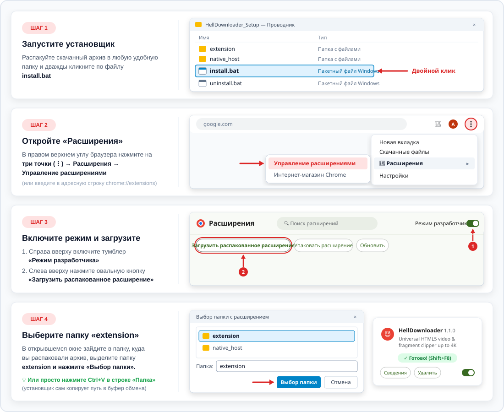

# 😈 HellDownloader (Русская версия)

> 🌐 **Язык / Language:** **[🇬🇧 English (Click here)](README.md)** | **🇷🇺 Русский**

**HellDownloader** — универсальное расширение для браузера и локальный медиа-движок для Windows 10/11, позволяющие сохранять как **полные видеоролики (до 4K 60fps и MP3)**, так и **вырезать точные фрагменты с покадровой точностью** прямо поверх стандартного видеоплеера на любых сайтах и видеоплатформах.

---

## 📥 СКАЧАТЬ В 1 КЛИК (Для обычных пользователей)

> **Не нужно ничего искать в файлах выше!** Просто нажмите на большую ссылку ниже — скачивание архива установщика начнётся автоматически:

### 👉 [**СКАЧАТЬ HellDownloader_Setup.zip (Установщик для Windows 10/11)**](https://github.com/ArkadyYum/HellDownloader/releases/latest/download/HellDownloader_Setup.zip) 👈

---

## 🖼️ Наглядная инструкция по установке в Windows и Chrome (За 1 минуту)



### Пошагово для новичков:
1. **Распакуйте и запустите `install.bat`:**
   * Нажмите на ссылку [**СКАЧАТЬ HellDownloader_Setup.zip**](https://github.com/ArkadyYum/HellDownloader/releases/latest/download/HellDownloader_Setup.zip) выше, откройте скачанный архив, перетащите папку в любое место (например, на Рабочий стол) и дважды кликните по файлу **`install.bat`**.
   * *Примечание:* если Windows покажет синее окошко SmartScreen («Система Windows защитила ваш компьютер»), нажмите **«Подробнее»** → **«Выполнить в любом случае»**.
   * Подождите пару секунд до появления надписи `Installed Successfully!`. Установщик сам подготовит папку `C:\Users\Public\HellDownloader` и **автоматически скопирует путь к папке расширения в ваш буфер обмена**!
2. **Откройте страницу расширений в браузере:**
   * Откройте ваш браузер (Chrome, Яндекс Браузер, Edge, Brave, Opera) и введите в адресную строку:
     * Для Chrome / Edge / Brave / Opera: `chrome://extensions/`
     * Для Яндекс Браузера: `browser://extensions/`
3. **Включите «Режим разработчика»:**
   * Переключите тумблер **«Режим разработчика» (Developer mode)** в правом верхнем углу страницы в положение **ВКЛ**.
4. **Нажмите «Загрузить распакованное расширение»:**
   * Нажмите кнопку **«Загрузить распакованное расширение» (Load unpacked)** в левом верхнем углу.
5. **Вставьте путь (`Ctrl+V`) и нажмите «Выбор папки»:**
   * В открывшемся стандартном окне выбора папки Windows просто нажмите **`Ctrl+V`** в поле «Папка:» (путь `C:\Users\Public\HellDownloader\extension` уже скопирован!) и нажмите кнопку **«Выбор папки»**.
6. **Готово!** Откройте любое видео в браузере и нажмите **`Shift+F8`** на клавиатуре (горячую клавишу можно в любой момент поменять прямо в шапке панели).

### 🗑️ Как полностью удалить приложение:
* Запустите файл **`uninstall.bat`** — он за 1 секунду удалит все файлы из `C:\Users\Public\HellDownloader` и очистит записи в реестре.
* В браузере на странице `chrome://extensions/` нажмите **«Удалить» (Remove)** на карточке **HellDownloader**.

---

## ✨ Основные возможности

* **🎬 Полное видео или ✂️ Вырезка фрагмента:** ползунки начала (`S`) и конца (`E`) встраиваются прямо поверх родной полосы прокрутки видеоплеера.
* **Точность до 1 кадра (`1f` / `1s`):** кнопки пошаговой подгонка границ фрагмента, фиксация длительности (`🔒`) и предпросмотр выбранного отрезка в цикле (`▶ Preview Clip`).
* **Автовыбор глав и таймкодов:** клик по любому размеченному эпизоду на таймлайне плеера автоматически выставляет ползунки `S` и `E` по границам этого эпизода и подставляет его название.
* **Работа с прямыми эфирами (Live):** запись отрывка прямо из идущего стрима.
* **Встроенный DoH-мост:** стабильная работа даже при сбоях или ограничениях системного DNS провайдера.
* **Поддержка всех Chromium-браузеров:** Google Chrome, Яндекс Браузер, Microsoft Edge, Brave, Opera / Opera GX, Vivaldi.
* **Тихое автообновление:** раз в сутки в фоновом режиме проверяются обновления компонентов и движка.

---

## ❤️ Поддержать автора

Проект распространяется полностью бесплатно. Если **HellDownloader** экономит вам время и радует в работе, вы можете поддержать автора любой суммой:
* 🔥 **[Поддержать на DonationAlerts (yumarkady)](https://www.donationalerts.com/r/yumarkady)**

Если вы столкнулись с ошибкой на каком-либо сайте — нажмите кнопку **`😡 Report Bug`** прямо в окне расширения после скачивания, и отчёт мгновенно прилетит разработчику.

---

## 🛠️ Архитектура проекта (Для разработчиков и ИИ-ассистентов)

Подробное описание архитектуры и файлов проекта находится в основном файле [`README.md`](README.md).
После любых изменений в `extension/*` или `native_host/*` выполняйте синхронизацию рабочей копии:
```powershell
node "native_host\register.js"
```
А для пересборки релизного архива `HellDownloader_Setup.zip` запускайте `package.bat`.
