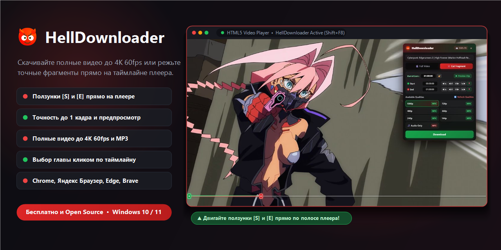

<div align="center">
  

  # 😈 HellDownloader

  **Универсальное расширение и локальный медиа-движок для скачивания видео до 4K 60fps и покадровой нарезки фрагментов прямо в браузере (Windows 10/11).**

  <p>
    
    
    
    
    
    
    
    
  </p>

  <p>
    <a href="https://github.com/ArkadyYum/HellDownloader/releases/latest"></a>
    <a href="https://github.com/ArkadyYum/HellDownloader/releases/latest/download/HellDownloader_Setup.zip"></a>
    
    
  </p>

  <p>
    🌐 <b>Язык / Language:</b> &nbsp; <a href="README.md"><b>🇬🇧 English (Click here)</b></a> &nbsp;·&nbsp; <b>🇷🇺 Русский</b>
  </p>

  <p>
    <i>Никакого копирования ссылок в отдельные программы, никакого повторного входа в аккаунты, никакой рекламы. Если HellDownloader экономит вам время — поставьте ⭐ звезду в правом верхнем углу!</i>
  </p>
</div>

---

## ✨ Основные возможности

* **🎬 Полное видео или ✂️ Вырезка фрагмента:** ползунки начала (`S`) и конца (`E`) встраиваются прямо поверх родной полосы прокрутки видеоплеера во время просмотра.
* **Точность до 1 кадра (`1f` / `1s`):** кнопки пошаговой подгонки границ фрагмента, фиксация длительности (`🔒`) и предпросмотр выбранного отрезка в цикле (`▶ Preview Clip`).
* **Автовыбор глав и таймкодов:** клик по любому размеченному эпизоду на таймлайне плеера автоматически выставляет ползунки `S` и `E` по границам этого эпизода и подставляет его название.
* **Работа прямо в вашем родном браузере:** не нужно копировать ссылки в отдельную десктопную программу или заново логиниться во встроенный браузер.
* **Работа с прямыми эфирами (Live):** запись отрывка прямо из идущего стрима.
* **Встроенный DoH-мост:** стабильная работа даже при сбоях или ограничениях системного DNS провайдера.
* **Поддержка всех Chromium-браузеров:** Google Chrome, Яндекс Браузер, Microsoft Edge, Brave, Opera / Opera GX, Vivaldi.
* **Тихое автообновление:** раз в сутки в фоновом режиме проверяются обновления компонентов и движка.

---

## 📥 СКАЧАТЬ И УСТАНОВИТЬ (За 1 минуту)

> **Не нужно ничего искать в файлах выше!** Просто нажмите на большую ссылку ниже — скачивание архива установщика начнётся автоматически:

<div align="center">

### 👉 [**СКАЧАТЬ HellDownloader_Setup.zip (Установщик для Windows 10/11)**](https://github.com/ArkadyYum/HellDownloader/releases/latest/download/HellDownloader_Setup.zip) 👈

</div>


### Кратко по шагам:
1. **Запустите `install.bat`:** распакуйте скачанный архив `HellDownloader_Setup.zip` в любую удобную папку и дважды кликните по файлу **`install.bat`** (*если появится синее окно SmartScreen — нажмите **«Подробнее»** → **«Выполнить в любом случае»***).
2. **Откройте «Расширения» в браузере:** нажмите на **три точки `⋮`** в правом верхнем углу браузера → **Расширения** → **Управление расширениями** (или введите в адресную строку `chrome://extensions`).
3. **Включите режим и загрузите:** включите тумблер **«Режим разработчика»** справа вверху, затем нажмите овальную кнопку **«Загрузить распакованное расширение»** слева вверху.
4. **Выберите папку `extension`:** в открывшемся окне зайдите в папку, куда вы распаковали архив, выделите папку **`extension`** (или просто нажмите **`Ctrl+V`** в строке «Папка») и нажмите **«Выбор папки»**.
5. **Готово!** Откройте любое видео в браузере и нажмите **`Shift+F8`** на клавиатуре (горячую клавишу можно в любой момент поменять прямо в шапке панели).

### 🗑️ Как полностью удалить приложение:
* Запустите файл **`uninstall.bat`** — он за 1 секунду удалит рабочие файлы и очистит записи в реестре.
* На странице `chrome://extensions` нажмите **«Удалить»** на карточке **HellDownloader**.

---

## ❤️ Поддержать автора

Проект распространяется полностью бесплатно. Если **HellDownloader** экономит вам время и радует в работе, вы можете поддержать автора любой суммой:
* 🔥 **[Поддержать на DonationAlerts](https://www.donationalerts.com/r/yumarkady)**

Если вы столкнулись с ошибкой на каком-либо сайте — нажмите кнопку **`😡 Report Bug`** прямо в окне расширения после скачивания, и отчёт мгновенно прилетит разработчику.

---

## 🛠️ Архитектура проекта (Для разработчиков и ИИ-ассистентов)

Подробное описание архитектуры и файлов проекта находится в основном файле [`README.md`](README.md).
После любых изменений в `extension/*` или `native_host/*` выполняйте синхронизацию рабочей копии:
```powershell
node "native_host\register.js"
```
А для пересборки релизного архива `HellDownloader_Setup.zip` запускайте `package.bat`.
